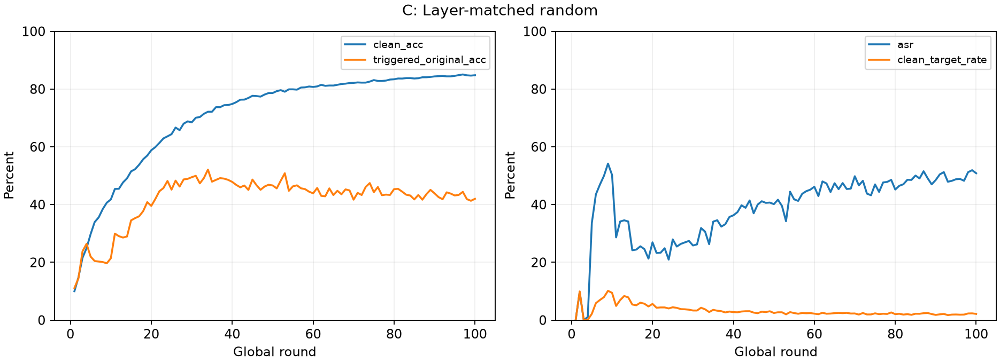

# C: Layer-matched random

状态：completed；已完成评估 100 / 100 轮。

- 最后一轮 Clean ACC：84.78%
- 最后一轮 ASR：50.84%
- 同一非目标干净测试集合预测为目标类：2.14%
- 带触发器图片原标签准确率：41.99%

这是使用真实恶意身份和配对正常更新的 Oracle 实验，不是可部署防御。所有参与客户端均按数据量加权 FedAvg，不执行 AlphaGuard 淘汰或重加权。差集定位沿用前批诊断公式 abs(delta)/(abs(reference)+epsilon)，不是调用原生 AlphaGuard 的过滤流程。

每轮均进行干预，每组有独立全局模型。A/B/C/D 从相同初始模型和数据划分出发，后续轨迹会分叉。随机组每个客户端每轮一次独立抽样；并非多种子统计验证。poison_frac=0.3 沿用原生“非目标类候选集的 30%”语义。

## 文件

- run.json：设置、状态、源代码哈希、实际轮数、起始模型和数据划分指纹。
- console.log：本组完整控制台输出；Global 轮次、参与/恶意/良性名单、定位分数及修复数量。
- tables/metrics.csv：逐轮全局指标。
- tables/client_round.csv：逐客户端定位和替换幅度、聚合权重、攻击/正常更新差异。
- tables/layer_round.csv：恶意客户端各层差集与随机集合数量。
- snapshots/：指定轮次的聚合前全局模型、恶意更新、配对正常更新、修复索引和参与客户端权重。
- final_model.pt：最后一轮模型。
- source_snapshot/：本次执行源码快照。

默认只保存最后一轮完整配对快照，控制服务器磁盘占用。中间轮的统计仍逐轮保存。
