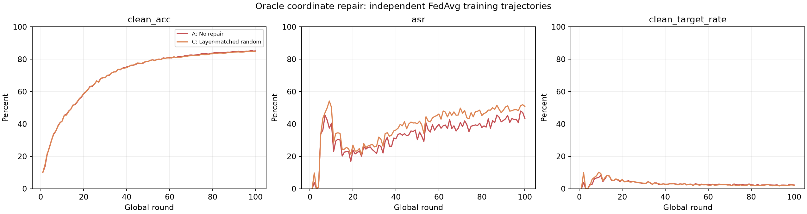
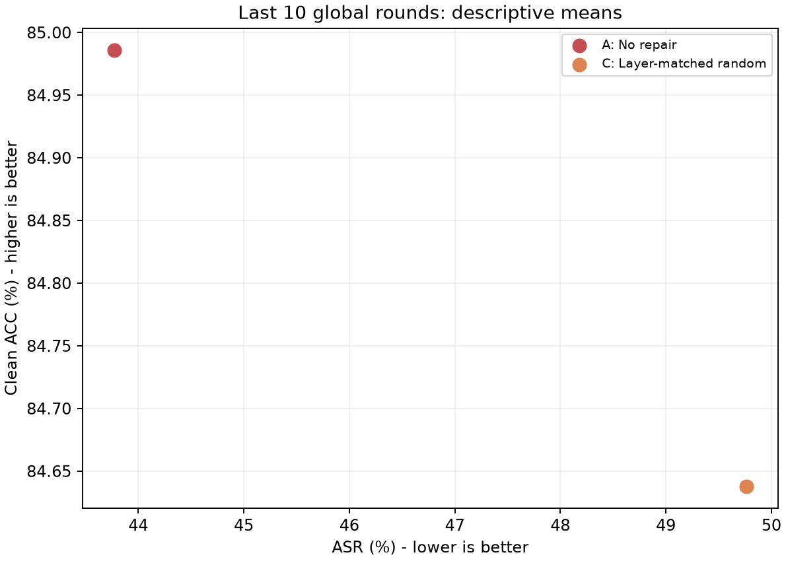
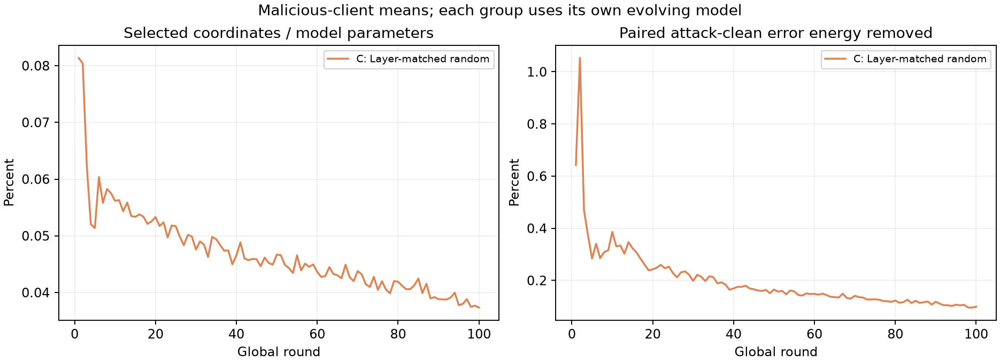

# RAMP Oracle 四组实验

四组独立训练，每轮干预，所有客户端按数据量加权 FedAvg；不执行 AlphaGuard 淘汰。

|组别|状态|报告|
|---|---|---|
|A: No repair|completed|[本组报告](A_no_repair/report.md)|
|B: Promoted repair|running|[本组报告](B_promoted_repair/report.md)|
|C: Layer-matched random|completed|[本组报告](C_random_repair/report.md)|
|D: Full clean update|not_started|[本组报告](D_full_clean/report.md)|

已完成 2/4 组。只有 completed 组进入对比图；运行中可先查看各组 tables/metrics.csv。

|组别|最终 ACC|最终 ASR|末10轮 ACC|末10轮 ASR|
|---|---:|---:|---:|---:|
|A_no_repair|85.08%|43.56%|84.99%|43.77%|
|C_random_repair|84.78%|50.84%|84.64%|49.76%|

替换预算/差异能量图是几何诊断，不等价于 ASR 修复效果。B/C 后期轨迹不同，预算也可能自然分叉。

## 解释边界

优先比较 B 对 A 的 ASR 降幅与 ACC 代价，再比较 B 对 C 的额外价值，D 是完整正常更新参考。本批不包含“原始幅值修复”第五组。随机组只有一条训练轨迹，不是随机重复置信区间。
真实恶意身份用于选取修复对象，配对正常更新用于替换，因此这是 Oracle 机制验证。各组后续全局模型不同，最终差异包含训练反馈；不能只凭终局曲线推断单坐标因果效应。
第一轮快照指纹可验证同起点；各组末轮完整配对快照可用于后续局部反事实分析。
