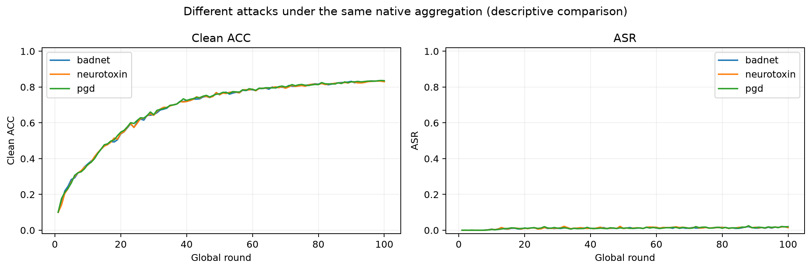
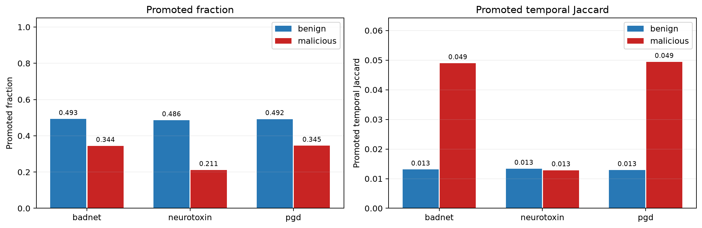
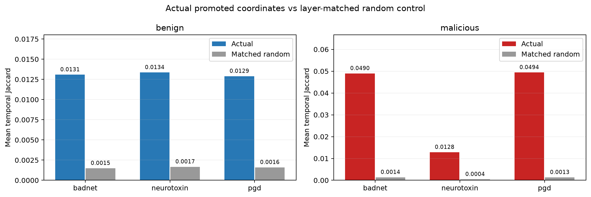

# RAMP Top-K 独立实验批次

这是不同攻击在同一原生聚合算法下的结构诊断，不是不同防御算法的效果比较。

|攻击|训练状态|报告状态|已观察轮数|详细报告|
|---|---|---|---:|---|
|badnet|completed|generated|100|[查看](badnet/report.md)|
|neurotoxin|completed|generated|100|[查看](neurotoxin/report.md)|
|pgd|completed|generated|100|[查看](pgd/report.md)|

汇总数值：[summary.csv](comparison/summary.csv)。首轮没有时间稳定性数据；单种子结果仅供描述分析。每项实验的配置及源码快照位于其独立目录。

随机集合与当轮差集的数量及层分布一致，且排除原始 Top-K。该对照不增加训练，也不参与聚合；用于判断坐标重合度是否超过条件随机水平。
