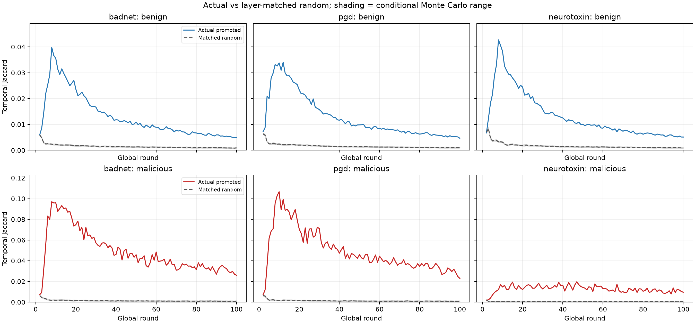
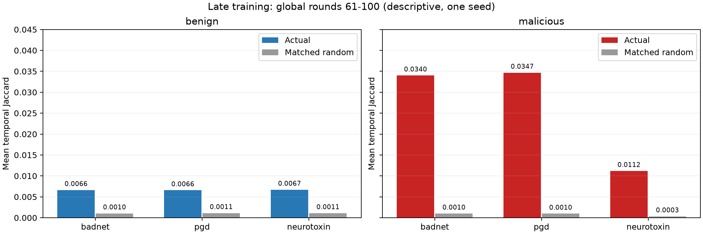

# 本次 RAMP Top-K 实验结果分析

结论：差集具有超过按层匹配随机基线的时间结构；BadNets 下恶意客户端更稳定，Neurotoxin 的角色区分较弱。这支持继续做 Oracle 恢复，但还不证明差集是后门功能坐标。

三项实验均完整完成 100 个全局轮次，共 6,000 个客户端轮次观测和 180,000 条随机重复记录。本分析只读取已有 CSV、日志及源码快照，不重新训练、不修改原始结果。

## 1. 训练状态

|攻击|最终 Clean ACC|最终 ASR|末10轮平均 ACC|末10轮平均 ASR|
|---|---:|---:|---:|---:|
|badnet|83.05%|1.52%|83.06%|1.53%|
|pgd|83.54%|2.00%|83.25%|1.74%|
|neurotoxin|82.98%|1.46%|82.88%|1.61%|

全局准确率约 83%，没有全局模型坍塌的迹象；ASR 较低。这些是现有 AlphaGuard 下的结果，RAMP 修复尚未启用，不能称为 RAMP 的防御效果。未记录同样非目标干净图片预测为目标类的比例，也没有本批无攻击基线，因此不能量化残余 ASR 中的后门成分。

## 2. 差集稳定性与随机对照

以下先看后期 Global 61—100，减少将初期变化与后期状态混在一起。

|攻击|良性实际 Jaccard|良性随机|恶意实际 Jaccard|恶意随机|
|---|---:|---:|---:|---:|
|badnet|0.00663|0.00105|0.03401|0.00100|
|pgd|0.00657|0.00112|0.03467|0.00097|
|neurotoxin|0.00670|0.00110|0.01118|0.00034|

- 后期 BadNets 和原生 PGD 的恶意差集实际 Jaccard 约为良性的 5 倍；Neurotoxin 约为 1.7 倍，绝对区分弱一些。
- 良性差集也长期高于随机，所以“高于随机”不能直接作为恶意判据。
- 全程中同角色均值超过模拟 97.5% 分位数的轮次如下；轮次不独立，不将计数解释为正式显著性检验。

|攻击|良性超过模拟上界|恶意超过模拟上界|
|---|---:|---:|
|badnet|98/99|99/99|
|pgd|99/99|99/99|
|neurotoxin|98/99|98/99|

具体坐标的绝对 Jaccard 仍较低，不能描述成一批基本不变的固定坐标。原始 Top-K 的时间 Jaccard 普遍高于相对 Top-K，也不支持“相对排序让坐标更稳定”这一说法。当前可支持的是差集存在非随机的持续成分，而非其稳定性优于所有其他选法。

## 3. 集中在哪些层

全程主要集中于 conv2、conv3、conv4 的卷积权重和 res1 两个卷积权重；良性、恶意有较多共同区域。下面为各攻击恶意客户端的全程主要参数张量，按实际差集份额排序。

|攻击|参数张量|差集份额|按参数量归一富集度|
|---|---|---:|---:|
|badnet|conv4.0.weight|31.04%|1.73×|
|badnet|conv2.0.weight|18.16%|16.19×|
|badnet|conv3.0.weight|18.07%|4.03×|
|badnet|res1.0.0.weight|14.61%|6.51×|
|badnet|res1.1.0.weight|11.56%|5.15×|
|pgd|conv4.0.weight|32.37%|1.80×|
|pgd|conv3.0.weight|17.92%|3.99×|
|pgd|conv2.0.weight|16.94%|15.10×|
|pgd|res1.0.0.weight|13.79%|6.15×|
|pgd|res1.1.0.weight|11.82%|5.27×|
|neurotoxin|conv4.0.weight|33.23%|1.85×|
|neurotoxin|conv3.0.weight|16.66%|3.71×|
|neurotoxin|res1.0.0.weight|14.48%|6.45×|
|neurotoxin|res1.1.0.weight|13.05%|5.82×|
|neurotoxin|conv2.0.weight|10.58%|9.43×|

角色内按轮汇总的层分布相邻余弦相似度全程约 0.981—0.995，后期约 0.993—1.000。层分布比具体坐标稳定，但这也是良性更新具有的结构特征；余弦还会受大层主导。该指标是角色汇总层分布的稳定性，不代表每个客户端或具体坐标都不变。
后期分类头在 BadNets/PGD 恶意差集约占 3.3%，良性约 1.8%；Neurotoxin 恶意仅约 0.67%，说明攻击机制不同，不能把某一层直接固定为通用后门区域。差集约 96%—99% 来自卷积权重，不是由 BN 可训练仿射参数主导，BN running 状态原本就未进入本诊断。

## 4. 两个影响解释的重要实现事实

### PGD 投影后期未生效

日志有 800 次投影前检查，实际投影 12 次，触发轮次及次数为 {"1": 8, "2": 4}。后 98 轮未触发投影。
本次源码快照 src/agent.py 以 0.1×全局模型 L2 为 CIFAR-10 投影半径，只在本地更新超出该半径时投影。因而不能将这里与 BadNets 相近的结果视为两种充分独立攻击机制的重复验证。这是本次原生实现和参数下的事实，不是所有 PGD 方法的一般结论。

### poison_frac=0.3 的实际含义

源码快照 src/utils.py::poison_dataset 对非目标类候选样本取 30%，不是对整个本地数据集取 30%。根据日志中的原始客户端类别分布及源码规则，实际数量推导如下（不是额外保存的投毒清单）。

|恶意客户端|本地样本数|非目标类候选|推导投毒数|占全部本地样本|
|---|---:|---:|---:|---:|
|0|2737|2715|814|29.74%|
|1|2831|2830|849|29.99%|
|2|2812|1680|504|17.92%|
|3|2203|1601|480|21.79%|

四个恶意客户端按样本数合计约 25.01%。这属于框架原生配置语义，论文应明确写成候选集比例，或后续另设“占全部本地数据 30%”实验；本次未修改代码。

## 5. epsilon 与参考

后期全模型约 99.8% 的参考坐标绝对值小于 epsilon=0.001；epsilon 在这些分母中至少与参考同等重要。这不是除零错误，也不能据此断定相对排序失效；但不能忽略其正则化尺度对排序的影响。现有比例统计针对全模型，不是入选差集坐标的比例；本次未保存相应坐标值，因此不能进一步推断其选中分母分布。

## 6. 对 RAMP 后续设计的判断

1. 值得继续做小范围 Oracle 坐标恢复，优先 BadNets，再检查 Neurotoxin 的适用边界。
2. 差集比例本身不能当恶意分数：良性全程约 49%，BadNets/PGD 恶意约 34%，Neurotoxin 恶意约 21%。
3. 不应只凭坐标属于差集就衰减；活动范围阈值 C 和客户端强度 omega 仍需验证，并报告良性误修复。
4. Oracle 应比较实际集合与同数量同层随机集合、原始 Top-K，以及全部坐标恢复上限；需要同客户端反事实正常更新。
5. 当前只有单种子、单数据集、单模型、固定恶意客户端身份。Non-IID 客户端差异可能混入角色差异，不能由当前结构统计直接推出后门因果作用。
6. 本次未保存完整模型或更新，CSV 和稀疏索引不能独立完成 Oracle；后续需要在新训练的选定轮次采集配对数据。

阶段划分和角色层分布分析为事后描述，不是预注册检验；模拟范围不是置信区间。

## 可复核文件

- phase_summary.csv：全程、前期、中期、后期的角色统计。
- layer_summary.csv：各阶段、各角色的层份额和富集度。
- metrics_summary.csv：训练指标汇总。
- implementation_audit.csv：过滤记录、PGD 投影计数、耗时。
- poison_fraction_audit.csv：基于原始类别分布与源码规则的实际投毒比例推导。
- build_interpretation.py：本分析脚本；只处理已有结果。
