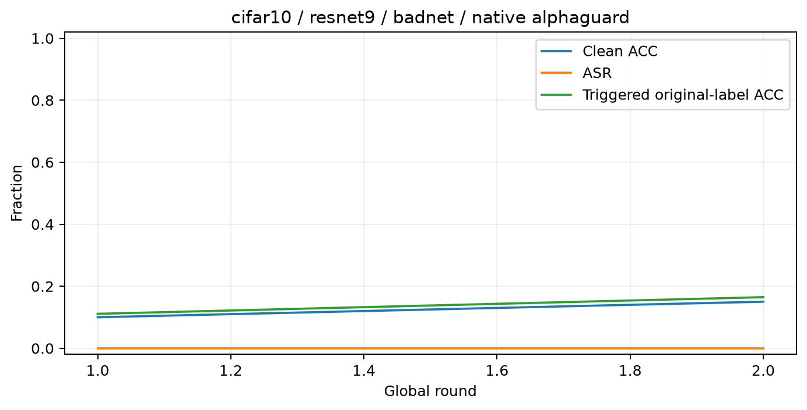
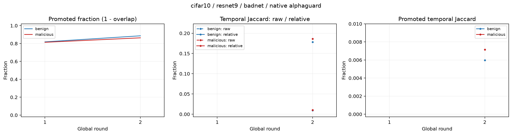
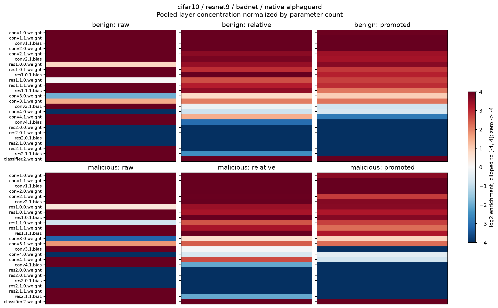
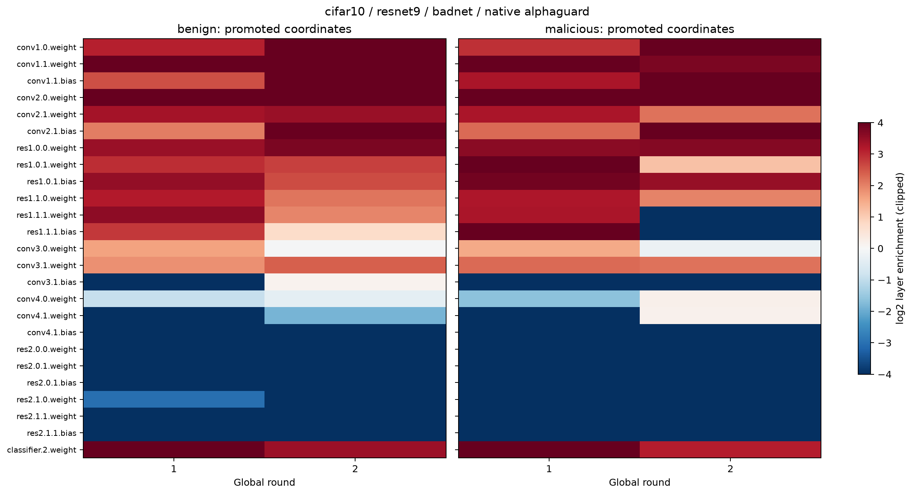
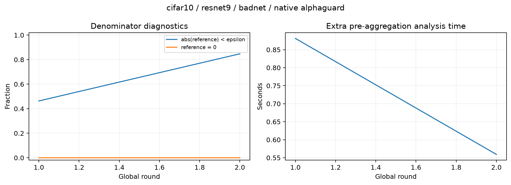
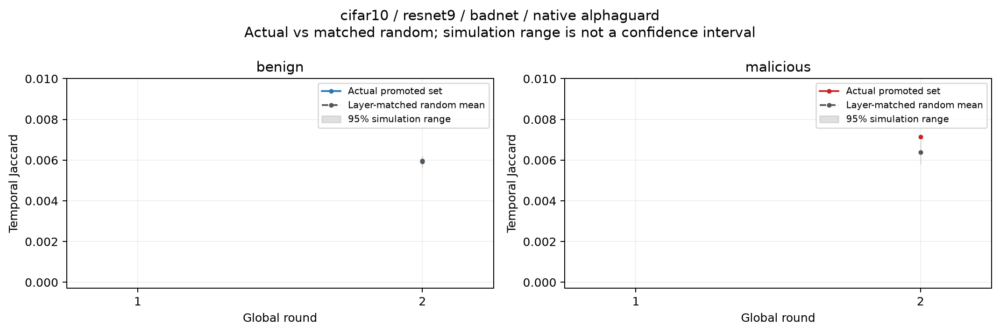

# RAMP Top-K 诊断：badnet

- 状态：**completed**；已观察全局轮数：2。
- 训练：`cifar10 / resnet9 / badnet / native alphaguard`；客户端 20，恶意 4，poison_frac=0.3，Non-IID beta=0.5，local_ep=2。
- 实际配置、公式、参数索引映射、版本及源码 SHA256：`run.json`；源码快照：`source_snapshot/`。
- 观察过滤前的全部上传更新；原生 AlphaGuard 评分、过滤及聚合保持原样。
- 本次相对特征使用 `abs(delta)/(abs(reference)+epsilon)`，不是原生 AlphaGuard 的内部相除公式。
- 范围：可训练参数的本地模型差值，不是某个 batch 的梯度；BatchNorm 状态不参与本诊断。

## 如何读这些结果

- 原始集合：`TopK(abs(delta))`；相对集合：`TopK(abs(delta)/(abs(reference)+epsilon))`。
- 差集（promoted）：相对集合减去原始集合；两个 Top-K 使用同一个 K。
- overlap=`交集大小/K`；promoted fraction=`差集大小/K`，二者之和为 1。
- temporal Jaccard：同一客户端相邻两次参与时集合的交并比；首轮和两个空集记为空值。
- 层富集度=`该层占选中集合的比例/该层占全部可训练参数的比例`；1 为按参数量均匀分布。
- 层图汇总使用坐标计数汇总后的比例；空差集为缺失值，零计数与缺失值不同。
- 层指一个具名参数张量（如卷积权重或 BN 权重），索引映射见配置。

## 良性与恶意客户端对比

|角色|客户端-轮次观测数|原始/相对重合率|差集比例|相对集合时间 Jaccard|差集时间 Jaccard|
|---|---:|---:|---:|---:|---:|
|benign|32|0.1477|0.8523|0.0096|0.0060|
|malicious|8|0.1614|0.8386|0.0102|0.0071|

最后一次评估（Global 2）：Clean ACC=0.1502，ASR=0.0，触发图片原标签准确率=0.1648。

## 同层、同数量随机坐标对照

每客户端每轮独立抽样 30 次；独立随机种子为 20261111。

随机集合严格匹配当轮差集的每层坐标数量，并从该层原始 Top-K 以外无放回抽取。每个重复序列跨轮比较自己的随机集合，构成条件随机稳定性基线。

|角色|实际差集平均时间 Jaccard|随机平均时间 Jaccard|实际减随机|
|---|---:|---:|---:|
|benign|0.005976|0.005937|0.000039|
|malicious|0.007141|0.006384|0.000758|

图中先对每个重复内的同角色客户端求均值，再对重复均值取 2.5%—97.5% 分位数。该阴影是条件随机模拟范围，不是实验置信区间，也不表示跨种子显著性。
层分布已人为匹配，因此这个对照仅检验具体坐标的时间稳定性；层集中性仍看按参数量归一化的富集度。随机抽样不进入训练或聚合。

## 差集主要集中在哪里

|角色|参数张量|累计选中次数|差集坐标占比|层富集度|
|---|---|---:|---:|---:|
|benign|conv2.0.weight|57625|0.3214|28.658|
|benign|classifier.2.weight|3112|0.0174|22.287|
|benign|conv1.1.bias|38|0.0002|21.771|
|benign|conv1.1.weight|31|0.0002|17.761|
|benign|conv1.0.weight|712|0.0040|15.108|
|malicious|conv2.0.weight|14432|0.3273|29.178|
|malicious|classifier.2.weight|803|0.0182|23.378|
|malicious|conv1.1.bias|10|0.0002|23.291|
|malicious|conv1.1.weight|8|0.0002|18.633|
|malicious|conv2.1.bias|11|0.0002|12.810|

平均参考分量低于 epsilon 的比例：65.53%；每轮诊断平均额外耗时：0.720s。

## 图片

## 解释边界

- 本实验描述坐标结构与时间稳定性，不证明这些坐标具有后门因果作用；下一步需要 Oracle 恢复。
- 良性/恶意身份仅用于分组统计。参考候选可能包含恶意客户端，其比例记录在 round.csv。
- 参考候选不足时回退到全部参与者；回退标志已记录，没有使用真实良性身份。
- 若参考幅值普遍低于 epsilon，应结合分母诊断理解相对排序，不能直接认定为低活动后门坐标。
- 大量边界并列值会影响 Top-K 身份；client_round.csv 保存并列计数，暂不解释为严格稳定性证据。
- 当前为单种子描述实验；跨攻击训练轨迹不同，不构成严格的配对因果比较。
- 如果只运行 1 个全局轮次，时间稳定性图为空是正常的；至少 2 轮才有相邻轮次比较。
- 训练指标来自原生日志的四位小数；状态 failed/interrupted 的结果属于部分实验。

## 文件

- `tables/client_round.csv`：每客户端每轮集合、分数、角色、参考身份及时间稳定性。
- `tables/layer_round.csv`：每客户端每轮每参数张量的集合数量和归一化富集度。
- `tables/round.csv`：参考候选、分母与耗时诊断。
- `tables/metrics.csv`：逐轮训练评估；不会重复计入末尾 best-results 汇总。
- `tables/random_control.csv`：每客户端每轮每个随机重复的实际/随机时间 Jaccard；汇总同时写入 client_round.csv。
- `indices/`：默认保存 Global 1、每 25 轮及最后一轮的原始/相对坐标索引；差集可直接重算。
- `console.log`：完整控制台输出；不另写重复 training.log，不保存完整客户端更新向量。
